<div align="center">




```text
HP ██████████ 100%   CLASS agent builder   PING bengaluru   STATUS looking for a squad
```

</div>

### 🕹️ Player card

```yaml
name:      Karu Praneeth Kumar  (Bunny)
class:     Agentic AI Engineer
base:      Bengaluru, India  (open to remote)
current:   Intern Engineer @ Cyrene AI
looking:   true          # agentic AI / ML / Python backend roles, DMs open
endgame:   my own company
lore:      used to make PUBG videos. now I build the shooter.
```

### 🧭 Choose your path

<details>
<summary><b>🎯 Recruiter</b> · the 10-second version</summary>

<br>

- **Roles:** agentic AI, ML engineering, Python backend
- **Where:** Bengaluru, or remote
- **Now:** Intern Engineer @ Cyrene AI (payments + features across NetSepio's Erebrus apps)
- **Proof:** the kill feed below. Every line is a shipped repo. Full case files on my [portfolio](https://bunnypraneeth.pythonanywhere.com).

</details>

<details>
<summary><b>🛠️ Developer</b> · wanna build something</summary>

<br>

termfps wants players and contributors. Next up: fighting AI coding agents inside the game, then multiplayer over SSH.
Open an issue or DM me. I don't bite. My agents might.

</details>

<details>
<summary><b>🚀 Founder</b> · the long game</summary>

<br>

The endgame is my own agentic AI company. Right now I'm collecting scars, and every repo here is one.

</details>

<div align="center">

## I don't just build software. I build systems that act.

</div>

### 💀 Kill feed

```text
━━━━━━━━━━━━━━━━━━━━━━━━━━━━ KILL FEED ━━━━━━━━━━━━━━━━━━━━━━━━━━━━
 Bunny  [SOC Copilot]     ✖  alert fatigue
 Bunny  [TARS]            ✖  rate limits
 Bunny  [termfps]         ✖  "you need a GPU for 3D"
 Bunny  [Venue Copilot]   ✖  stadium chaos
 Bunny  [SeatHunter]      ✖  booking movie tickets by hand
 Bunny  [Toran]           ✖  wedding budget maths
━━━━━━━━━━━━━━━━━━━━━━━━━━━━━━━━━━━━━━━━━━━━━━━━━━━━━━━━━━━━━━━━━━━
```

### ⚔️ Quest log

<table>
<tr>
<td width="50%" valign="top">

**🛡️ [SOC Copilot](https://github.com/BunnyPraneeth5/SOC-Copilot)** &nbsp;

**Problem:** analysts drown in alerts.<br>
**Fix:** an offline analyst that doesn't just flag a bad IP, it sends agents to *investigate* it.

`99.88%` detection · CICIDS2017 · Isolation Forest + Random Forest · PySide6

</td>
<td width="50%" valign="top">

**🤖 [TARS](https://github.com/BunnyPraneeth5/TARS)** &nbsp;

**Problem:** agents die when a model gets rate-limited.<br>
**Fix:** extra lives. It respawns on the next model and keeps going.

`Level 6` on Agent Arena · Google ADK · Gemini · MCP

</td>
</tr>
<tr>
<td width="50%" valign="top">

**🎮 [termfps](https://github.com/BunnyPraneeth5/termfps)** &nbsp;

**Problem:** I wanted to learn Go.<br>
**Fix (obviously):** a 3D zombie shooter that runs inside your terminal.

`30 FPS` · no GPU · ~200 tests · Go + tcell

</td>
<td width="50%" valign="top">

**🏟️ [Venue Copilot](https://github.com/BunnyPraneeth5/Venue-Copilot)** &nbsp;

**Problem:** stadium dashboards make staff read charts.<br>
**Fix:** ask one question, three agents check the venue, get one action. [Try it live](https://venue-copilot.onrender.com).

`91` at PromptWars · solo build · FastAPI · Gemini

</td>
</tr>
</table>

### 📺 Live gameplay

<div align="center">

<a href="https://github.com/BunnyPraneeth5/termfps/blob/main/docs/termfps-demo.mp4"></a>

<sub>yes, this is a terminal. no, there's no GPU. <a href="https://github.com/BunnyPraneeth5/termfps/blob/main/docs/termfps-demo.mp4">▶ watch the 27-second demo</a></sub>

</div>

<details>
<summary><b>💀 Boss fight replays</b> · how the kills actually happened</summary>

<br>

| Boss | Where it attacked | How it went down |
|---|---|---|
| 🐉 **The Rate-Limit Hydra** | TARS, mid-benchmark: Gemini started throwing 429s | A provider pool with cooldowns. Cut off one head, the next model takes over |
| 👾 **The Lag Demon** | termfps over slow connections: truecolor frames are heavy | Shade-block and ASCII render modes, plus a colour threshold that roughly halves the traffic |
| 🧟 **The Alert Swarm** | SOC Copilot: one attack, a flood of near-identical alerts | Dedup windows that group related alerts into one |
| 🧮 **The Hallucinated Rupee** | Toran: an LLM doing wedding budget maths | Gemini proposes, plain tested Python verifies every rupee and date |
| 🎤 **Dead Air** | Live demo on stage: what if the AI call hangs? | A hard 10-second timeout that escalates anyway. The show goes on |

</details>

### 🏆 Achievements unlocked

`🥈 Superhuman Lab 2026 runners-up` `🏟️ PromptWars: 91` `🏅 Agents League: Reasoning Agents` `🔌 Anthropic MCP` `🎤 Ran TechTrotter 2K25 (25+ teams)`

### 🎒 Loadout


### 📡 Telemetry

<div align="center">


<sub>🐍 minimap</sub>

<picture>
  <source media="(prefers-color-scheme: dark)" srcset="https://raw.githubusercontent.com/BunnyPraneeth5/BunnyPraneeth5/output/github-snake-dark.svg" />
  
</picture>

</div>

<details>
<summary><b>🔒 Secret level</b> (you found it. click to enter)</summary>

<br>

```text
 ██████████████████████████████
 █▓▓▒▒░░                ░░▒▒▓▓█      LEVEL ??  ·  THE TERMINAL
 █▓▓▒▒░░     \(x_x)/    ░░▒▒▓▓█
 █▓▓▒▒░░       ─┼─      ░░▒▒▓▓█      ammo   25 / 50
 █▓▓▒▒░░       / \      ░░▒▒▓▓█      hp     ██████████
 █▓▓▒▒░░________________░░▒▒▓▓█      kills  you're next
 ██████████████████████████████
```

- My hackathon team at Superhuman Lab was called **Fans of Fun**. We came second. Fun was had.
- Someone in Mexico added **boss fights** to termfps for their kid. Best code review I've ever had.
- My agents stop **before** the payment button. I don't trust anyone with your money, including me.

</details>

<div align="center">

```console
bunny@ops:~$ contact --now
[+] identity verified
[+] systems operational
[+] next level loading...
```

[](https://bunnypraneeth.pythonanywhere.com)
[](https://linkedin.com/in/karu-praneeth-kumar)
[](https://x.com/Bunnypraneeth12)
[](mailto:karu.praneeth@gmail.com)

<sub>I reply faster than my agents do. Save point reached. GG.</sub>


</div>
